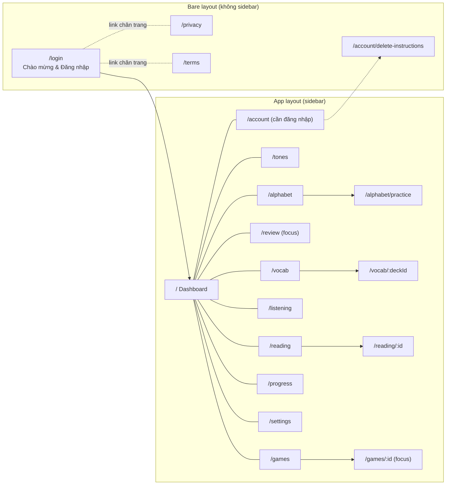
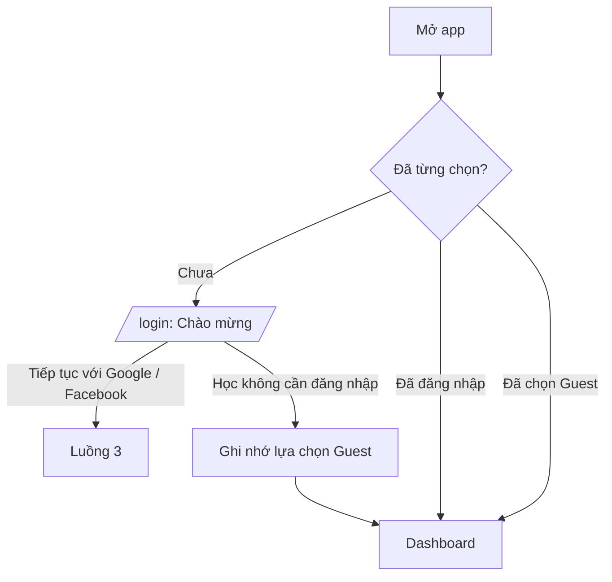
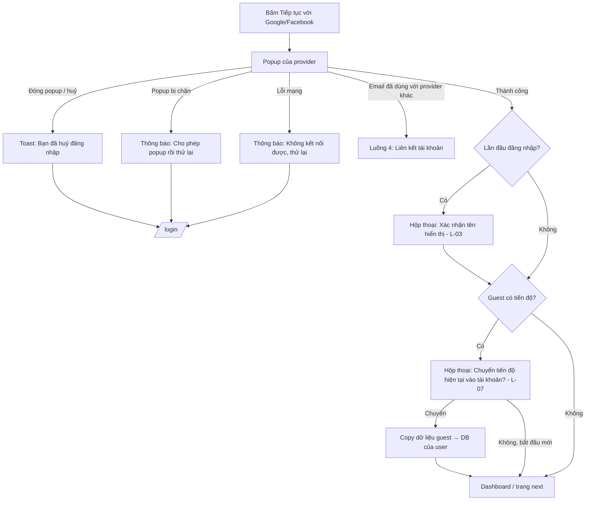
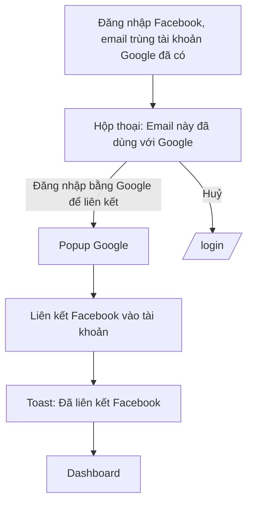
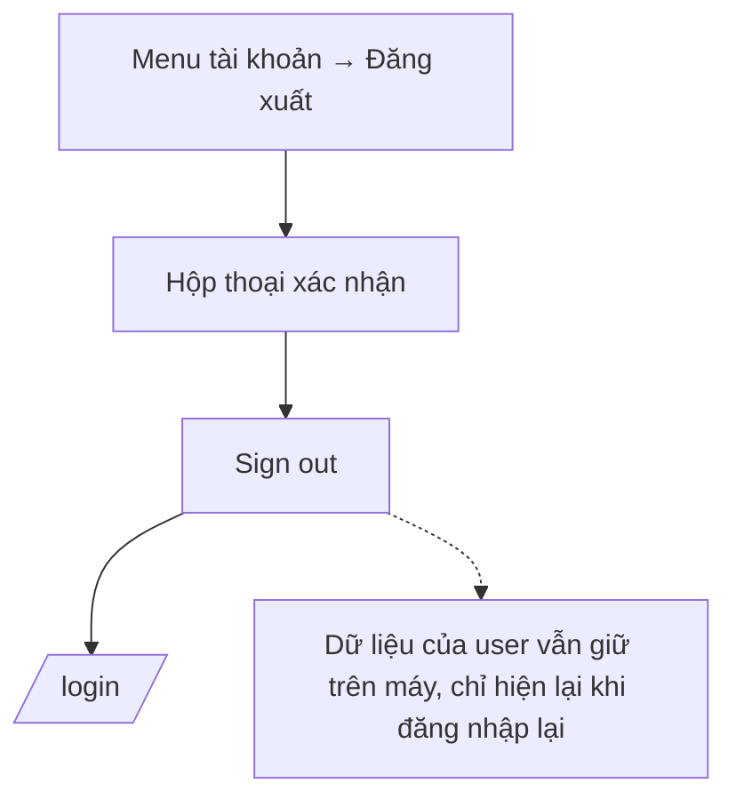
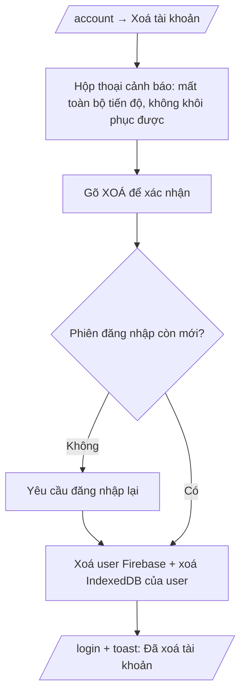

# Sitemap & luồng — Phase 1

> Trạng thái: **✅ Owner duyệt 2026-11-15** (M0.5a · D0.2). Requirement: L-01..L-10 (plan 4.0).

## 1. Sitemap Phase 1

**Quy tắc truy cập**
| Route | Guest | Đã đăng nhập |
|---|---|---|
| `/login` | ✅ | Chuyển về `/` |
| Mọi route học (`/`, `/alphabet`…) | ✅ (dữ liệu lưu trên trình duyệt này) | ✅ |
| `/account` | Chuyển về `/login?next=/account` | ✅ |
| `/privacy`, `/terms`, `/account/delete-instructions` | ✅ public | ✅ |

## 2. Lần đầu mở app

## 3. Đăng nhập (Google / Facebook)

## 4. Liên kết tài khoản cùng email (L-04)

## 5. Đăng xuất

## 6. Xoá tài khoản (L-08)

## 7. Offline (L-09)
- Đã đăng nhập trước đó + mất mạng → vẫn vào app, header hiện badge **"Ngoại tuyến"**.
- Nút đăng nhập / liên kết / xoá tài khoản bị **vô hiệu** khi offline, kèm giải thích.
